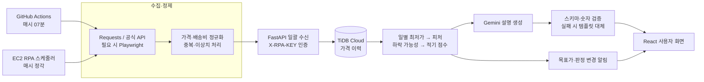

# PickTiming · 실시간 가격 비교 & 구매 타이밍 추천 서비스

> **“어디서 가장 싸게 살까?”에서 “지금 사도 될까?”까지.**
>
> 판매처별 실구매가와 과거 가격 흐름을 분석하고, 구매 판단의 근거를 자연어로 설명합니다.


[](https://github.com/fsclass-n/picktiming/actions/workflows/deploy.yml)
[](https://github.com/fsclass-n/picktiming/issues)

[](#license)

**[포트폴리오 · 발표·시연 영상 보기](https://fsclass-n.github.io/picktiming/)**

[서비스 체험](https://picktiming.netlify.app) · [운영 API 문서](https://picktiming.onrender.com/docs) · [발표자료 PDF](docs/pdf/프로젝트_발표자료.pdf)

**현재 구현 기준:** 가격 수집은 **1시간 주기**입니다. Netlify 체험 화면은 브라우저 목업 데이터를 사용하며, 화면의 상품·가격·관리자 지표는 운영 실적을 의미하지 않습니다.

## 주요 기능

| 사용자 질문 | 제공하는 기능 |
|---|---|
| 실제로 어디가 가장 저렴한가? | 판매가와 배송비를 합친 **실구매가** 비교, 판매처별 재고 확인 |
| 지금 가격은 평소보다 낮은가? | **7일·30일·90일** 가격 추이와 현재 가격 위치 시각화 |
| 지금 사는 것이 좋은가? | 가격 하락 가능성과 과거 가격 위치를 반영한 **적기 점수·판정** |
| 왜 그렇게 판단했는가? | 분석 수치에 근거한 **AI 구매 조언·상품 상담** |
| 원하는 가격까지 기다릴 수 있는가? | 관심 상품, 목표가 설정, 목표가 도달·판정 변경 알림 |
| 서비스가 정상적으로 운영되는가? | 관리자용 수집 로그, 모델 버전, AI 사용량·검증 상태, 회원 관리 |

## Architecture & Data Pipeline

수집기는 가격을 일괄 전송하고, 서버는 저장 후 적기 판정과 알림을 갱신합니다. Gemini는 서버가 계산한 분석 결과를 설명하는 역할을 맡습니다.



위 다이어그램은 공통 처리 흐름입니다. GitHub Actions 수집기는 **Render API**, EC2 수집기는 **EC2 API**로 전송합니다. 두 서버는 서로 호출하지 않고 같은 TiDB를 사용합니다.

| 환경 | 역할 | 설계 의도 |
|---|---|---|
| GitHub Pages | 단일 HTML 포트폴리오 | 별도 프레임워크 빌드 없이 프로젝트 소개 |
| Netlify | React 데모 · API·DB 연결 없음 | 운영 데이터 변경 없이 기능 체험 |
| Render | React 정적 파일 + FastAPI 풀스택 | 같은 도메인에서 화면과 API 제공 |
| AWS EC2 | nginx + FastAPI + RPA의 Docker Compose 구성 | 수집 스케줄러를 별도 컨테이너로 실행 |
| TiDB Cloud | 공용 운영 DB | 두 풀스택 환경의 가격·회원·관심 상품 저장 |

구성 근거: [컨테이너 스케줄러](rpa/collector/scheduler.py) · [Render 예약 수집](.github/workflows/collect-render.yml) · [EC2 Compose](docker-compose.yml)

## Key Technical Challenges & Solutions

### 1. 동적 페이지 대응과 브라우저 실행 비용 관리

**문제:** 판매처마다 가격 표기와 DOM 구조가 다르고, 일부 페이지는 JavaScript 실행 후에 가격을 표시합니다.

- 일반 페이지는 `Requests + BeautifulSoup`으로 처리하고, 수집 규칙에 `render: "playwright"`가 지정된 경우에만 Chromium을 실행합니다.
- Playwright는 **헤드리스 모드**, 선택자 대기, 타임아웃을 적용합니다. 모듈은 필요할 때 불러오고, 실행이 끝나면 `finally`에서 브라우저를 닫습니다.
- 요청 전 `robots.txt`를 확인하고 기본 **3초 간격**을 유지합니다. 일시적인 요청 실패는 지수 백오프로 재시도하며, 허용되지 않은 경로는 수집하지 않습니다.
- 판매처별 CSS 선택자를 코드에서 분리해 [수집 규칙](rpa/malls.json)으로 관리합니다.

**적용 범위:** 현재 Playwright 경로는 동기식입니다. 브라우저 재사용, 이미지·폰트 요청 차단, 제한된 비동기 병렬 처리는 후속 최적화 과제입니다.

근거: [HTTP 요청 정책](rpa/collector/http.py) · [브라우저 렌더링](rpa/collector/browser.py) · [가격 파서](rpa/collector/parsers.py)

### 2. 여러 수집 경로의 데이터 동기화와 중복 적재

**문제:** Render와 EC2 수집기가 같은 DB를 사용하므로, 같은 판매처의 가격이 반복 기록될 수 있습니다.

- **정규화:** 원화 표기를 정수로 변환하고 판매가·배송비·실구매가를 구분합니다. 가격이 없거나 0원이면 품절로 처리합니다.
- **정제:** pandas로 배치 내 `listing_id` 중복을 제거하고, 직전 가격 대비 ±50%를 초과한 재고 보유 상품의 가격 변동을 이상치로 제외합니다.
- **서버 중복 검사:** 판매처별로 같은 정시~59분 구간의 기존 기록을 조회하고, 이미 저장된 항목은 건너뜁니다. 응답에 `inserted`, `duplicate`, `skipped`를 구분합니다.
- **후속 처리:** 새 가격이 저장된 상품의 판정과 알림을 갱신한 뒤 커밋합니다.

동일 시간대 재전송을 건너뛰는 동작은 회귀 테스트로 확인합니다. 현재 중복 방지는 애플리케이션 조회에 기반하므로, 동시 요청까지 강제하려면 **수집 슬롯에 대한 DB 유일 제약과 원자적 적재**를 보강해야 합니다.

**30분 주기로 확장할 때:** 스케줄러와 cron뿐 아니라, 현재 1시간 단위인 중복 판정 구간도 30분 슬롯으로 함께 변경해야 합니다.

근거: [수집·정제 작업](rpa/collector/jobs.py) · [일괄 적재 API](backend/app/routers/rpa.py) · [중복·알림 테스트](backend/tests/test_rpa.py)

### 3. 추천 점수와 추천 이유를 같은 데이터에서 산출

**문제:** 현재 최저가만으로는 추가 하락 가능성을 설명하기 어렵고, 데이터가 부족한 상품에 확신 있는 판정을 주어서도 안 됩니다.

1. 재고가 있는 판매처의 **일별 최저 실구매가** 시계열을 구성합니다.
2. 최근 최대 90일의 가격 위치, 최저가 대비 비율, 7·30일 이동평균 대비 비율, 추세·변동성, 마지막 할인 이후 일수, 월말 여부를 피처로 만듭니다.
3. 활성 `RandomForestClassifier`로 **향후 7일 내 5% 이상 하락할 가능성**을 추정합니다. 활성 모델이 없으면 휴리스틱으로 대체합니다.
4. 하락 가능성과 가격 위치를 결합해 적기 점수를 계산합니다.

```text
적기 점수 = round((1 − 하락 가능성) × 70 + (1 − 가격 백분위) × 30)

70점 이상    → BUY_NOW    · 지금 구매 추천
40~69점      → WAIT_A_BIT · 조금 더 지켜보기
40점 미만    → WAIT       · 기다리기 권장
이력 30일 미만 → HOLD     · 판단 보류
```

학습과 추론은 같은 피처 함수를 사용합니다. 재학습은 날짜순 데이터와 `TimeSeriesSplit` 5분할로 평가하고, 기본 경로에서는 기존 모델의 F1과 비교해 교체 여부를 결정합니다.

**사용자별 적용:** 적기 점수는 상품 단위로 계산합니다. 개인화 범위는 사용자가 등록한 관심 상품·목표가와 상품별 질문에 대한 상담이며, 사용자 행동을 학습하는 개인별 랭킹 모델은 아직 구현하지 않았습니다.

근거: [가격 시계열](backend/app/services/pricing.py) · [피처·학습 라벨](backend/app/ml/features.py) · [학습·모델 등록](backend/app/ml/train.py) · [점수·판정](backend/app/services/timing.py)

### 4. 생성형 AI의 숫자 오류와 장애를 처리하는 응답 경로

**문제:** 자연어 설명이 분석 결과와 다른 가격·확률을 제시하면 추천의 근거가 흔들립니다.

```text
분석 결과를 표시 형식으로 정리
  → Gemini의 구조화된 JSON 응답
  → Pydantic 스키마 검증 + 입력에 없는 숫자 탐지
  → 숫자 검증 실패 시 1회 재요청
  → 재실패·API 오류 시 규칙 기반 설명
```

상품 ID·현재 가격·판정·모델 버전으로 조언 캐시 키를 구성하고, 사용자별 일일 사용량을 제한합니다. 응답 출처, 검증 결과, 토큰 사용량, 지연 시간을 기록해 관리자 화면에서 확인합니다.

숫자 대조는 입력에 없는 수치를 탐지하는 장치이며, 문장 전체의 의미적 정확성까지 보장하지는 않습니다.

근거: [Gemini 응답 검증](backend/app/ai/gemini.py) · [캐시·사용량 제한](backend/app/routers/ai.py) · [재요청·대체 응답 테스트](backend/tests/test_ai_ml.py)

### 5. 데모와 운영의 화면 재사용, 서버에서 재검증하는 권한

- React 화면은 공통으로 유지하고 [API 모듈](frontend/src/lib/api.js)이 운영 요청과 브라우저 목업을 분기합니다. 데모도 같은 API 형태로 동작해 UI 흐름을 재사용합니다.
- 관리자 화면은 `React.lazy`와 `Suspense`로 분리합니다.
- 로그인 화면은 하나이며, 계정의 `USER / ADMIN` 역할에 따라 메뉴와 접근 경로를 구분합니다.
- 관리자 API는 DB에서 조회한 사용자 역할을 다시 검사합니다. 테스트 관리자의 회원 권한 변경은 `403 DEMO_READ_ONLY`로 차단합니다.

근거: [React 화면](frontend/src/App.jsx) · [인증·권한 검사](backend/app/security.py) · [관리자 권한 회귀 테스트](backend/tests/test_auth_admin.py)

## Tech Stack

| 영역 | 기술 | 적용 |
|---|---|---|
| Backend | Python 3.11, FastAPI, Pydantic, SQLAlchemy 2 | API, 입력·응답 검증, 관계형 데이터 처리 |
| Frontend | React 19, Vite 8, Tailwind CSS v4, React Router | 상품 탐색·차트·알림·관리자 UI |
| RPA / Data | Requests, BeautifulSoup4, Playwright, pandas, NumPy | 수집, 선택적 동적 렌더링, 가격 정제·시계열 피처 |
| AI / ML | scikit-learn, Google Gemini | 가격 하락 가능성 추정, 분석 근거 설명 |
| DB | TiDB Cloud, PyMySQL | 운영 저장소; SQLite·MySQL 8은 테스트용 |
| Auth | JWT, bcrypt, `X-RPA-KEY` | 사용자 인증, 비밀번호 해싱, 수집기 인증 |
| Infra | GitHub Pages, Netlify, Render, AWS EC2, Docker Compose, nginx | 포트폴리오·데모·풀스택 배포 구성 |
| Quality | pytest, Ruff, Playwright, GitHub Actions | 회귀 테스트, 린트, 브라우저 검사, CI/CD |

## API Architecture

공통 접두사는 **`/api/v1`**입니다. 라우터는 인증과 요청 처리를 담당하고, 가격·추천·알림 로직은 서비스 계층으로 분리합니다.

| 영역 | 대표 엔드포인트 | 접근 |
|---|---|---|
| 인증 | `POST /auth/signup`, `POST /auth/login` | 공개 |
| 상품 탐색 | `GET /products/search` | 사용자 JWT |
| 가격 데이터 | `GET /products/{id}/compare`, `GET /products/{id}/prices` | 사용자 JWT |
| 구매 판단 | `GET /products/{id}/timing` | 사용자 JWT |
| AI 설명·상담 | `POST /products/{id}/advice`, `POST /ai/chat` | 사용자 JWT · 사용량 제한 |
| 수집 데이터 | `POST /rpa/prices/bulk` | `X-RPA-KEY` |
| 운영 지표 | `GET /admin/rpa-logs`, `GET /admin/ai-metrics` | `ADMIN` |
| 회원 권한 | `PATCH /admin/users/{id}/role` | `ADMIN` · 테스트 관리자 변경 금지 |

헬스 체크는 접두사 없이 `GET /health`로 제공합니다. 전체 계약은 [OpenAPI 문서](https://picktiming.onrender.com/docs)에서 확인할 수 있습니다.

## Directory Structure

```text
picktiming/
├── index.html                 # GitHub Pages 포트폴리오
├── backend/
│   ├── app/
│   │   ├── routers/           # 인증·상품·AI·수집·관리자 API
│   │   ├── services/          # 가격 집계·적기 판정·알림
│   │   ├── ml/                # 피처·학습·모델 저장
│   │   ├── ai/                # Gemini·수치 검증·대체 응답
│   │   ├── models.py          # SQLAlchemy 모델
│   │   └── security.py        # JWT·역할·수집기 인증
│   └── tests/
├── frontend/
│   ├── src/App.jsx            # 고객 UI·라우팅
│   ├── src/pages/             # 관리자 화면
│   ├── src/lib/               # API 어댑터·데모 목업
│   └── tests/ui_smoke.py      # 브라우저 회귀 검사
├── rpa/
│   ├── collector/             # HTTP·브라우저·파싱·정제·스케줄러
│   ├── malls.json             # 판매처별 수집 규칙
│   └── tests/
├── .github/workflows/         # CI·경로별 배포·Render 예약 수집
├── deploy/                    # nginx·EC2 배포 설정
├── docs/                      # 설계·운영·발표 자료
└── docker-compose.yml         # EC2 풀스택 구성
```

## Verification & Engineering Outcomes

성과는 구현 코드와 회귀 검사의 연결로 제시합니다. 데모 대시보드의 F1·수집 성공률·응답 시간은 운영 성능의 근거로 사용하지 않습니다.

| 검증 대상 | 확인하는 동작 | 근거 |
|---|---|---|
| 가격 적재 | 같은 시간대 재전송 건너뛰기, 목표가 알림 생성 | [수집 API 테스트](backend/tests/test_rpa.py) |
| AI 응답 | 잘못된 숫자 재요청, 반복 실패·API 오류 시 대체 응답 | [AI·ML 테스트](backend/tests/test_ai_ml.py) |
| 인증·권한 | 일반 사용자의 관리자 API 차단, 테스트 관리자 변경 거부 | [권한 테스트](backend/tests/test_auth_admin.py) |
| 수집 정제 | 가격 파싱, 품절 처리, 이상치·중복 제거, 예약 작업 판정 | [수집기 테스트](rpa/tests/test_collector.py) |
| 사용자 흐름 | 검색·목표가·가입·알림·관리자 접근·모바일 레이아웃 | [브라우저 시나리오](frontend/tests/ui_smoke.py) |
| CI | SQLite·MySQL 8 테스트, RPA 린트·테스트, React·Docker 빌드 | [CI 정의](.github/workflows/ci.yml) |

배포 워크플로는 [변경 경로 판별](.github/scripts/detect-changes.sh)로 Netlify·Render·EC2 대상을 선택합니다. 브라우저 시나리오는 별도의 검사 스크립트이며, 현재 CI의 React 빌드 작업과 구분합니다.

## 로컬에서 화면 확인

Node.js 22 기준, 저장소 루트에서 실행합니다. 기본 데모 설정은 서버·운영 DB 없이 동작합니다.

```bash
cd frontend
npm ci
npm run dev
```

백엔드·수집기 구성과 환경 변수는 [개발·운영 문서](docs/md/README.md)를 참고하세요. 로컬 `.env`가 공용 TiDB를 가리킬 수 있으므로 운영 DB에 초기화 명령을 실행하지 않습니다.

## 다음 개선 과제

| 과제 | 검증할 내용 |
|---|---|
| 수집 처리량 | 브라우저 재사용·리소스 차단·제한된 병렬 처리의 메모리와 소요 시간 비교 |
| 수집 간격·동시성 | 30분 슬롯 도입 시 스케줄·중복 키 동시 변경, DB 유일 제약과 동시 적재 테스트 |
| 추천 품질 | 실제 가격 이력 기반 평가, 7일 예측 구간을 고려한 검증 경계 보강, 판정 적중률 집계 |
| AI 설명 품질 | 숫자 검증을 넘어선 의미 일치 평가, 응답 지연·토큰 비용 실측 |

## Team

3조 팀 프로젝트입니다. 아래 이름은 가상 인물 표기이며, 역할별 구현 근거는 발표자료와 코드에서 확인할 수 있습니다.

| 이름 | 담당 |
|---|---|
| 박미금 | 조장 · PM · 데이터/AI |
| 김모란 | 백엔드 · 배포 |
| 이오리 | 프런트엔드 · UI/UX |
| 홍기흥 | RPA · 데이터 수집 |

## License

현재 저장소 루트에 프로젝트 전체의 사용·배포 조건을 정하는 `LICENSE` 파일은 없습니다. 개별 의존성과 포함된 도구의 라이선스는 각각의 원문을 따릅니다.
