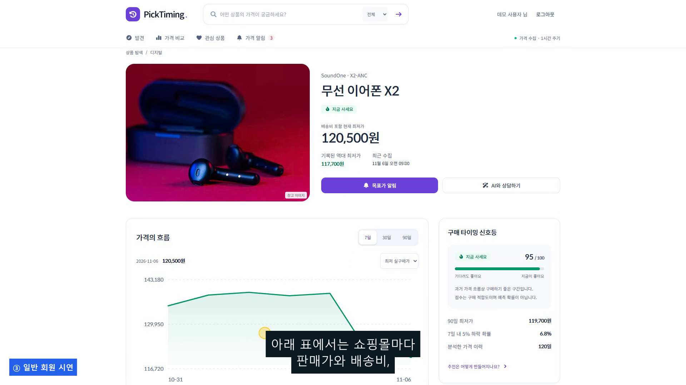
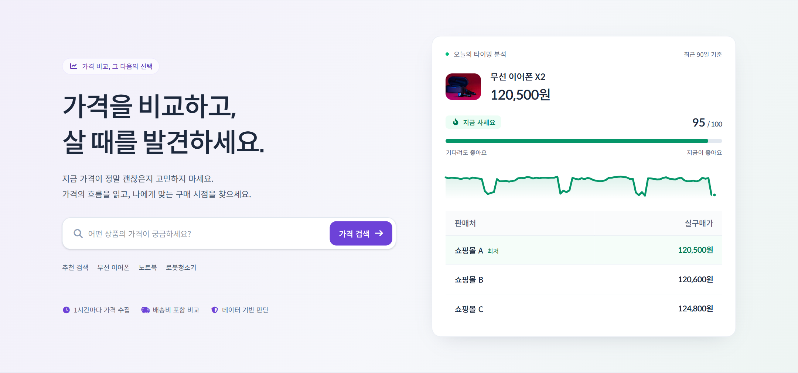
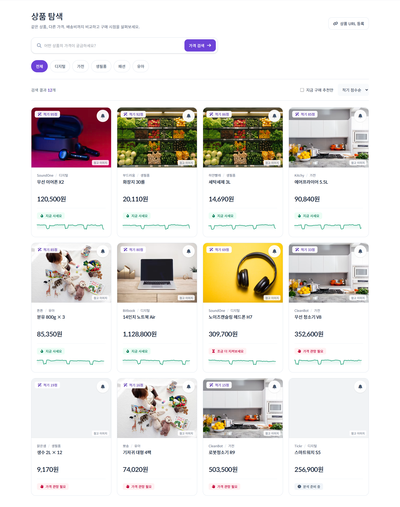
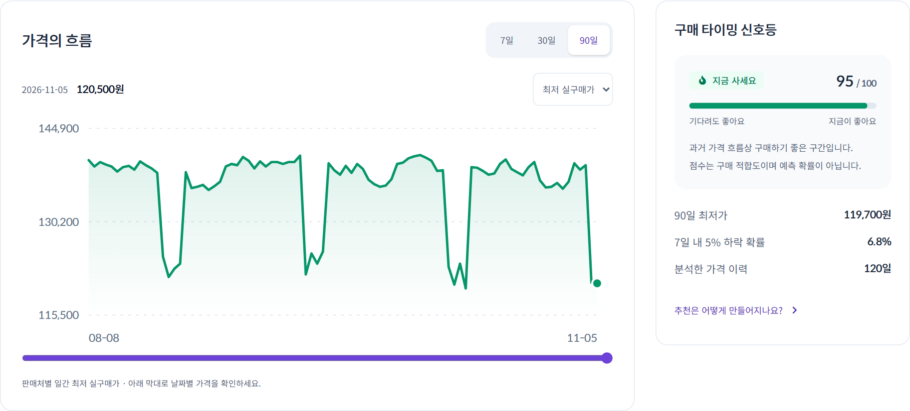
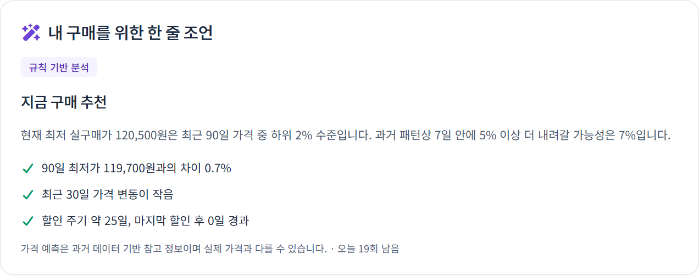
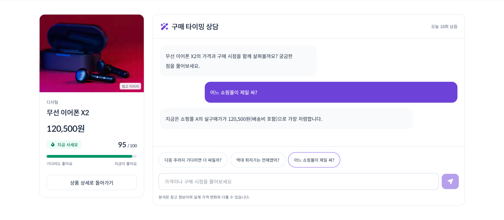
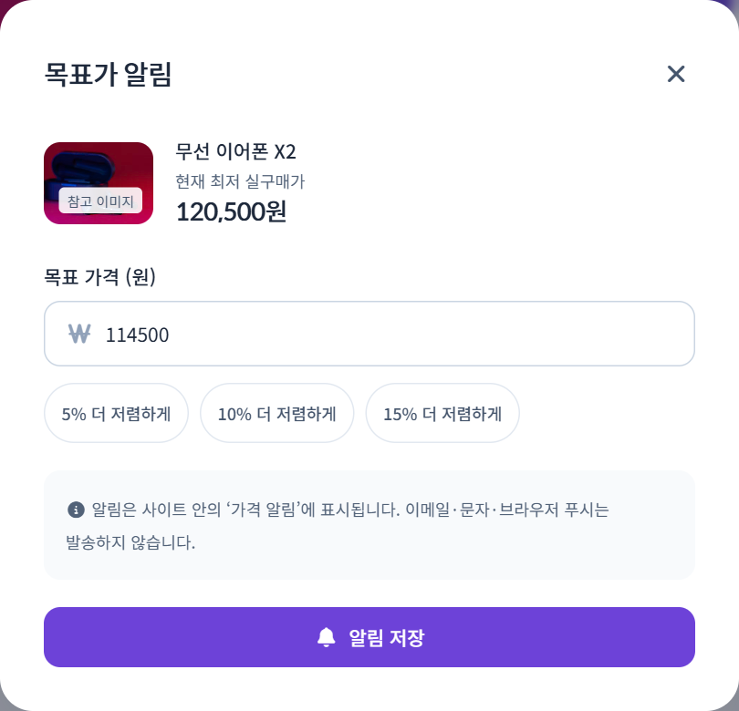
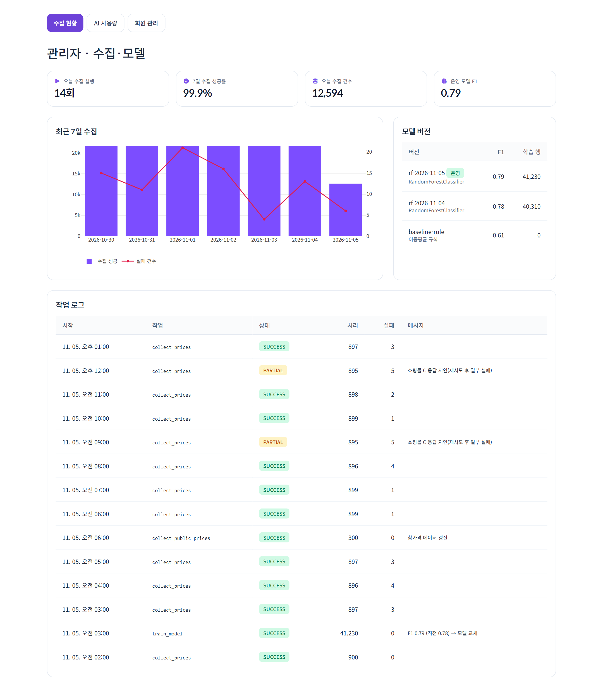
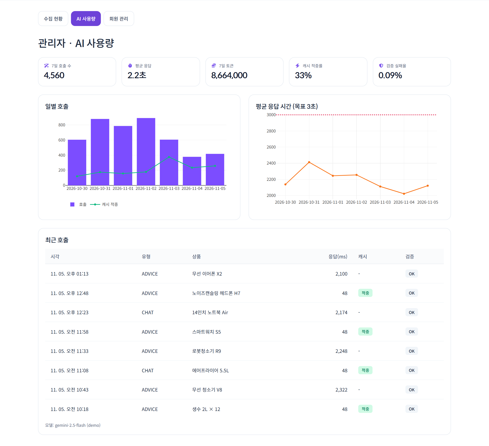
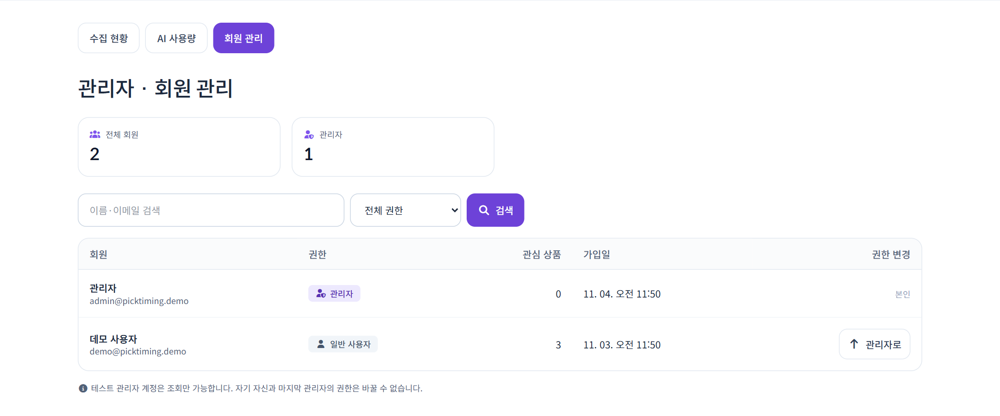

````markdown
# PickTiming (픽타이밍)

> 가격 비교를 넘어, 구매 타이밍까지 — 생성형 AI & RPA 기반 실시간 가격 비교·구매 타이밍 추천 플랫폼

[](https://github.com/fsclass-n/picktiming/actions)
**데모** https://picktiming.netlify.app · **운영** https://picktiming.onrender.com · **API 문서** https://picktiming.onrender.com/docs

## 🎬 발표·시연 영상 (10분)

[](https://github.com/fsclass-n/picktiming/releases/latest/download/3조_final.mp4)

60초 하이라이트 (README에서 바로 재생 — GitHub 웹 편집기에 `docs/video/3조_highlight.mp4`를 끌어다 놓아 생긴 주소로 교체):

https://github.com/user-attachments/assets/여기에-하이라이트-업로드-주소

자막: [docs/video/3조_final.srt](docs/video/3조_final.srt)

| 시간 | 내용 |
|---|---|
| 00:00 | PPT 발표 — 팀 역할·아키텍처·기술 선택·역할별 심화·문제 해결·테스트 |
| 03:00 | 화면 전환 — 데모 사이트 |
| 03:30 | 일반 회원 — 가입·검색·실구매가·가격 흐름·AI 조언·목표가·알림·관리자 차단 |
| 06:30 | 관리자 — 수집 현황·AI 사용량·회원 관리(조회 전용)·API 문서·CI |
| 09:00 | 클로징 — 회고(한계·다음 단계)·링크 |

## 📸 스크린샷

| | | |
|---|---|---|
| **홈** | **상품 탐색** | **가격 흐름·신호등** |
|  |  |  |
| **AI 조언** | **AI 상담** | **목표가 알림** |
|  |  |  |
| **관리자 수집·모델** | **관리자 AI 사용량** | **회원 관리** |
|  |  |  |

> 화면의 상품·가격·관리자 수치는 데모 데이터입니다.

## 🏗 아키텍처

- React(Vite·Tailwind) → FastAPI(`/api/v1`, API 34개) → TiDB(테이블 12개)
- RPA 수집기(1시간) → 수집 API(X-RPA-KEY) → 판정·알림 / scikit-learn 적기 점수 / Gemini 설명(숫자 검증·대체)
- 배포: Netlify(데모) · Render(풀스택 운영) · AWS EC2(compose 구성) · GitHub Actions(CI·변경 경로별 배포·예약 수집)

## 🧰 기술 스택

| 영역 | 기술 |
|---|---|
| 화면 | React 19 · Vite 8 · Tailwind CSS v4 |
| 서버 | Python 3.11 · FastAPI · SQLAlchemy 2 · JWT |
| 데이터 | TiDB Cloud · MySQL 8(CI) · SQLite(테스트) |
| AI/ML | scikit-learn RandomForest · Google Gemini |
| 수집 | Requests · BeautifulSoup4 · Playwright(선택) |
| 배포 | Netlify · Render · AWS EC2 · GitHub Actions |

## 👥 팀

| 이름 | 역할 |
|---|---|
| 박미금 | 조장 · PM · 데이터/AI |
| 김모란 | 백엔드 · 배포 |
| 이오리 | 프런트엔드 · UI/UX |
| 홍기흥 | RPA · 데이터 수집 |

## ✅ 품질

백엔드 테스트 51 · RPA 테스트 11 · 브라우저 시나리오 9 · CI(SQLite·MySQL 8·Docker)

## 📂 문서

발표·포트폴리오 PPT(18장) `docs/프로젝트_발표자료.pptx` · PDF `docs/pdf/프로젝트_발표자료.pdf` · 운영 문서 `docs/md/` · 영상 가이드 `docs/video/`
````
